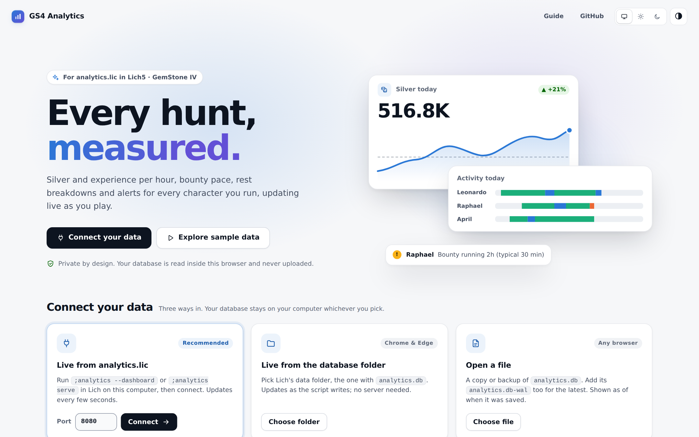
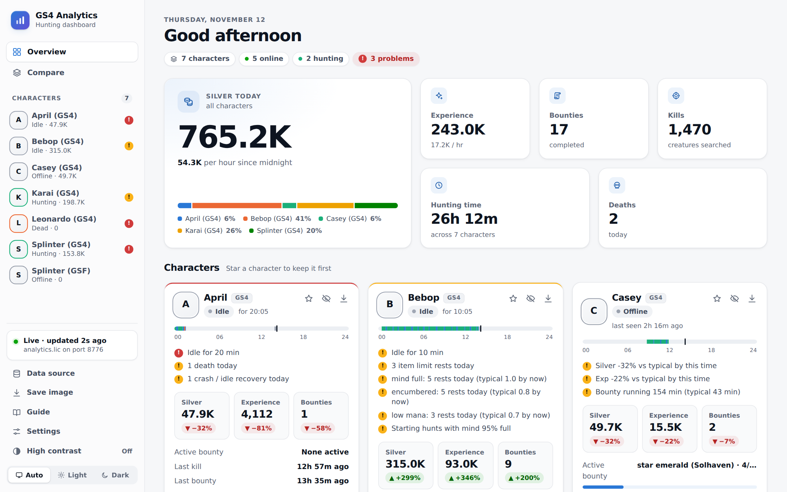
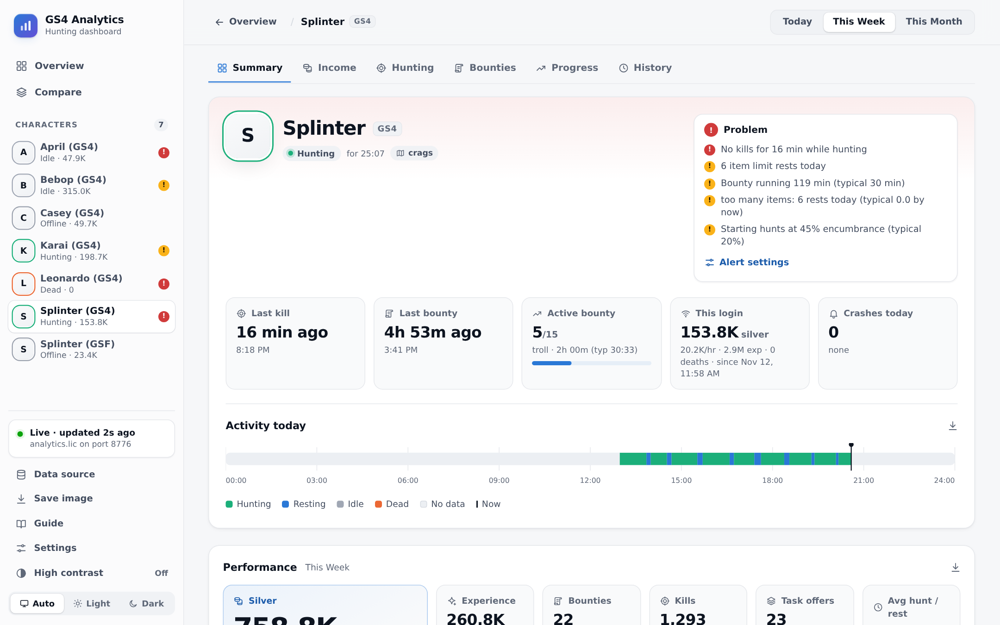
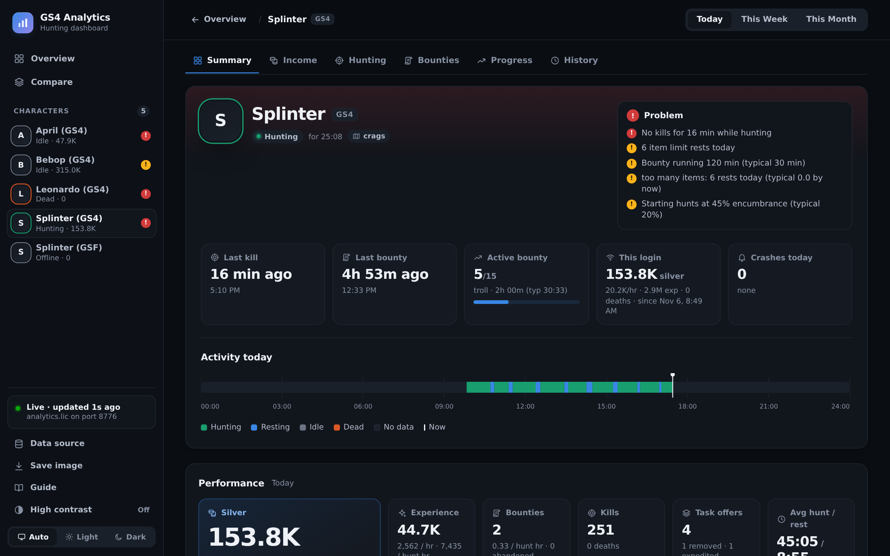
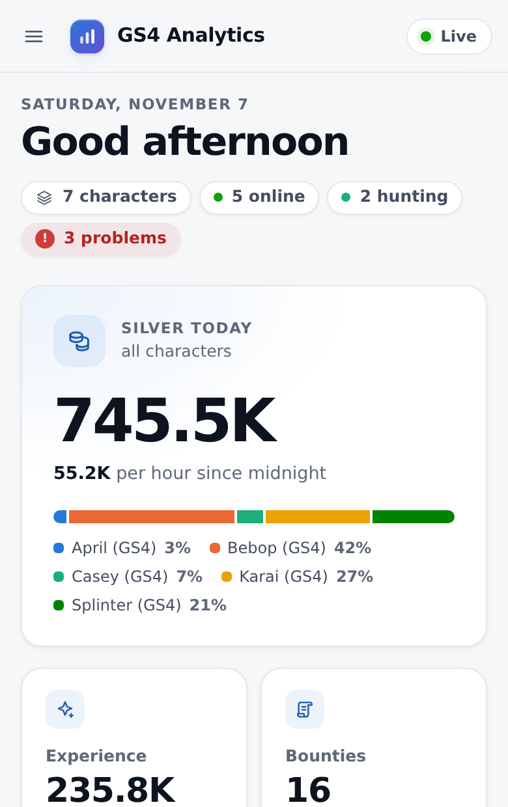
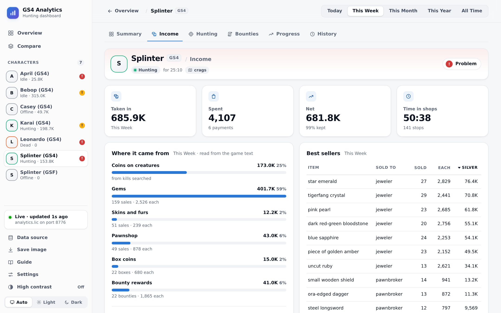
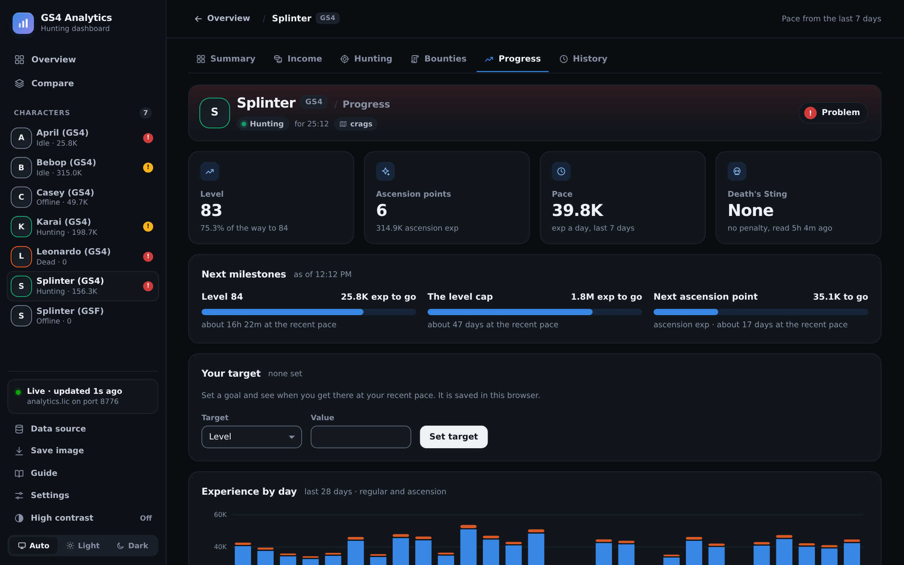
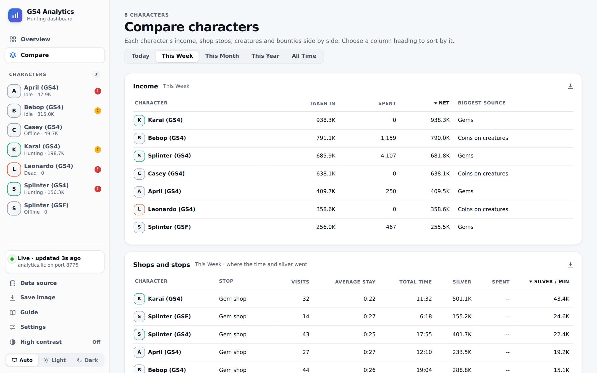
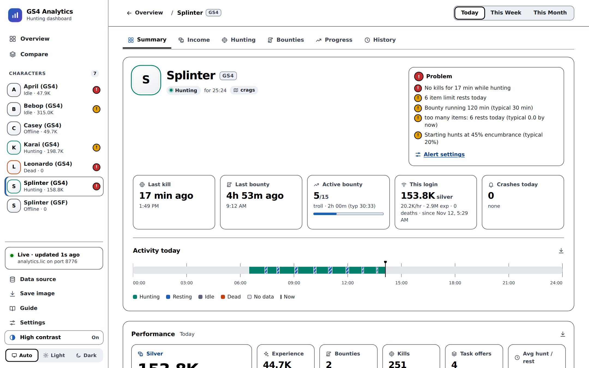

# GS4 Analytics dashboard

A web dashboard for [`analytics.lic`](https://github.com/elanthia-online/scripts/pull/2556),
the Lich5 script that records your Gemstone IV hunting: hunt and rest cycles, silver,
experience, kills, bounties and task offers. It is published at
**https://analytics.elanthia.online/**.

The page runs entirely in your browser. It opens your `analytics.db` with
[sql.js](https://github.com/sql-js/sql.js) (SQLite compiled to WebAssembly) and works out
every figure locally. Your data is never uploaded anywhere.

> **Status:** analytics.lic serves this page its database as of
> elanthia-online/scripts@0b41f063, schema 8 as of 7bfc369a (PR
> elanthia-online/scripts#2556, not merged yet). The
> script no longer has a dashboard of its own. What changed is in
> [docs/script-changes.md](docs/script-changes.md).

**Try it without installing anything: https://analytics.elanthia.online/?demo** opens the
site's sample data (made-up characters).

**How to install, run and configure analytics.lic is in the guide:
https://analytics.elanthia.online/guide/** (`site/guide/`). The script's header points
there. What's planned is in [docs/roadmap.md](docs/roadmap.md).

## Screenshots

From the site's sample data (`site/demo/sample.db`, built by `npm run sample` from the test
fixture): seven made-up characters, served live by the mock API. Click one for the whole page. `npm run screenshots` regenerates them.

<table>
  <tr>
    <td colspan="2" valign="top">
      <a href="docs/images/landing.png"></a>
      <br><b>First visit</b>: connect analytics.lic, its database folder or a file, or look around with the sample data first.
    </td>
  </tr>
  <tr>
    <td width="50%" valign="top">
      <a href="docs/images/overview.png"></a>
      <br><b>Overview</b>: today across every character, each one's state and pace against a typical day, the day's activity and alerts.
    </td>
    <td width="50%" valign="top">
      <a href="docs/images/character.png"></a>
      <br><b>A character</b>, for the week: right now, performance and trends, rests, hunting grounds, bounties and task offers.
    </td>
  </tr>
  <tr>
    <td width="50%" valign="top">
      <a href="docs/images/character-dark.png"></a>
      <br><b>Dark mode</b>: follows the system, or pick Light or Dark.
    </td>
    <td width="50%" valign="top" align="center">
      <a href="docs/images/phone.png"></a>
      <br><b>On a phone</b>
    </td>
  </tr>
  <tr>
    <td width="50%" valign="top">
      <a href="docs/images/income.png"></a>
      <br><b>Income</b>: where the silver came from, what was spent, the best sellers, and every shop stop by town.
    </td>
    <td width="50%" valign="top">
      <a href="docs/images/progress.png"></a>
      <br><b>Progress</b>: the next level or training point and ascension point with ETAs, experience by day, Death's Sting.
    </td>
  </tr>
  <tr>
    <td colspan="2" valign="top">
      <a href="docs/images/compare.png"></a>
      <br><b>Compare</b>: every character side by side, from today to all time; sort any table by a column.
    </td>
  </tr>
  <tr>
    <td colspan="2" valign="top">
      <a href="docs/images/character-contrast.png"></a>
      <br><b>High contrast</b>: on from the sidebar, or by itself when your system asks for more contrast. Works with light and dark.
    </td>
  </tr>
</table>

## Using it

Open the page and choose where the data comes from:

| Source | How | Live? | Browsers |
|---|---|---|---|
| **analytics.lic** | Run `;analytics --dashboard` (or `;analytics serve`) in Lich, then *Connect* (port 8080 unless you changed it). The script prints a link that connects for you | Yes, updates every 5 seconds | Chrome, Edge, Firefox. Safari unverified |
| **Database folder** | *Choose folder* and pick Lich's data folder, the one containing `analytics.db`. No server needed | Yes, re-reads every 5 seconds | Chrome, Edge |
| **Sample data** | *Explore sample data*, or open `/?demo`. Made-up characters, moved to today; a banner says so, and it's never remembered as your source | No | Any modern browser |
| **A file** | *Choose file* and pick a copy or backup of `analytics.db` (add `analytics.db-wal` too for the very latest) | No, shown as of when the file was saved | Any modern browser |

The page remembers your choice. A live connection reconnects by itself. A folder needs one
click to allow access again after the browser restarts.

Chrome and Edge ask once whether this site may *access other apps and services on this
device*. Allow it, because that's how the page reaches analytics.lic on `127.0.0.1`.

## What's here

```
site/                 the published site, served as is (no build step)
  index.html          page shell and Content-Security-Policy
  guide/index.html    the player guide: install, commands, reports, settings, FAQ
  css/guide.css       the guide's reading layout (on dashboard.css's tokens)
  css/dashboard.css   styles (from the script's page)
  js/app.js           UI (from the script's page) + source chooser
  js/data.js          sources (live API, folder, file) and the open database
  js/wal.js           rebuilds a live database from analytics.db + analytics.db-wal
  js/db.js            row access over sql.js
  js/aggregate/       every figure: a port of the script's Ruby dashboard
  vendor/sql.js/      sql.js 1.15.2 browser build, MIT, with checksums
test/                 node --test suites and the parity fixtures
tools/                dev server, mock analytics.lic API, e2e check, fixture generator
docs/                 working docs: start at docs/README.md
```

## Development

Needs Node 22 or newer. No other runtime dependencies.

```bash
npm install                 # sql.js, for the tests
npm test                    # parity with the Ruby dashboard + WAL reader (TZ is pinned by the script)
npm run serve               # site/ on http://localhost:8000
npm run mock -- --demo      # a stand-in analytics.lic API on 127.0.0.1:8080, data moved to "now"
npm run e2e                 # Chromium against the mock: live, detail, file and error paths
npm run a11y                # accessibility: axe-core (WCAG 2.2 AA) on every view and theme, and the colour tokens
```

Then open http://localhost:8000/?live=8080.

- `npm run e2e` needs Playwright's Chromium (`npx playwright install chromium` if you don't
  have it).
- `npm run screenshots` retakes the README's screenshots (`docs/images/`: each page whole, plus a same-sized preview of its top) from the sample
  data, through the mock API in demo mode. Retake them when the UI changes.
- `npm run vendor` refreshes `site/vendor/sql.js` after a sql.js version bump. Dependabot
  (`.github/dependabot.yml`, weekly) proposes bumps for the workflow actions and the npm dev
  dependencies. A sql.js bump fails CI's vendor check until `npm run vendor` is run and committed
  on its branch.

The parity fixtures came from `tools/gen-fixtures.rb`, run against the Ruby dashboard the
script had then. They're frozen now: the script no longer has that dashboard, and the tool
can't run against it. A new schema is admitted by converting them
([docs/data-contract.md](docs/data-contract.md)); see also [docs/porting-notes.md](docs/porting-notes.md).

## Publishing

`.github/workflows/pages.yml` publishes `site/` to GitHub Pages on every push to `main`,
after the tests pass. The repository's Pages source must be set to **GitHub Actions**
(Settings → Pages). The custom domain `analytics.elanthia.online` is set there as
well, not with a `CNAME` file: an Actions deploy ignores one. DNS is a CNAME record to
`elanthia-online.github.io`, and the domain is verified for the organisation.
`https://elanthia-online.github.io/analytics/` redirects to it. The certificate is issued and
**Enforce HTTPS** is on, so `http://` requests redirect to `https://`.

## License

Not chosen yet. See [docs/open-questions.md](docs/open-questions.md). The vendored sql.js is
MIT licensed (`site/vendor/sql.js/LICENSE`).
